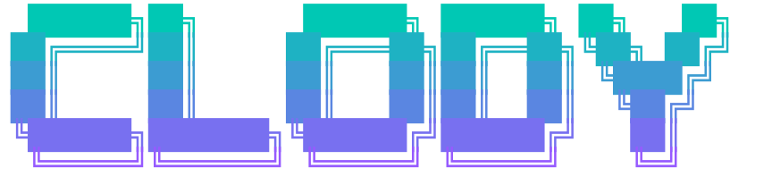

<p align="center">
  
</p>

<p align="center"><b>local-model coding agent</b></p>

<p align="center">
  <a href="LICENSE"></a>
  
  <a href="https://github.com/anomalyco/opencode"></a>
</p>

---

**clody** is a fork of [OpenCode](https://github.com/anomalyco/opencode) tuned for **local models** running on [Ollama](https://ollama.com). It keeps OpenCode's agent and TUI, and adds the missing pieces that make a small, on-device model behave like a usable coding agent: a curated model registry, hardware-aware model recommendation, automatic Ollama lifecycle + config generation, a tool-calling probe, and a context/skill layer built for short local context windows.

The whole point: **the bottleneck for local coding agents is usually the harness, not the model.** clody is the harness.

## Why clody

- **Zero cloud, zero keys.** Everything runs against your local Ollama. Your code never leaves the machine.
- **It picks a model for your hardware.** clody detects your RAM and recommends a model that will actually fit and run.
- **It only ships models that can call tools.** A coding agent is useless if the model can't emit structured tool calls. clody curates to native-tools models and gives you `clody probe` to verify any tag.
- **One command from nothing to a running agent.** `clody` ensures Ollama is up, pulls/recommends a model, writes the config, and launches the TUI.

## Quickstart

clody runs from source with [Bun](https://bun.sh). You'll also need [Ollama](https://ollama.com) installed.

```bash
git clone https://github.com/artser97/clody.git
cd clody
bun install

# launch clody — first run walks you through model selection,
# starts Ollama, writes config, and opens the TUI
bun packages/clody-cli/src/bin.ts
```

Optional: alias it so you can just type `clody`.

```bash
alias clody="bun $(pwd)/packages/clody-cli/src/bin.ts"
```

### Commands

| Command | What it does |
|---|---|
| `clody` | Launch the agent. First run (no config) opens the setup wizard. |
| `clody init` | Re-run the full setup wizard (hardware scan → model → config). |
| `clody model` | Change just the model. |
| `clody probe [tag…]` | Pull and probe models, reporting tool-calling support. Defaults to your configured model. |

`clody probe` is the fast way to check whether a model is agent-usable:

```
tag               stream  tools  parallel  reasoning        latency  verdict
qwen3-coder:30b   yes     yes    yes       none             4.3s     PASS
qwen2.5:14b       yes     yes    yes       none             5.3s     PASS
qwen2.5-coder:7b  yes     no     no        none             3.7s     FAIL (no tool_calls)
```

## Supported local models

clody's registry is curated to models that emit **structured tool calls** through Ollama's OpenAI-compatible endpoint — the prerequisite for agentic work. Recommendation is hardware-aware (each model declares its minimum RAM).

| Tag | Notes |
|---|---|
| `qwen2.5:14b` | coding · best agentic discipline (needs 16GB+) |
| `qwen2.5:7b` | coding · reliable tools · lighter |
| `gemma4:12b` | all-round default |
| `qwen3:8b` | general · reasoning |
| `qwen3:14b` | coding · reasoning · strong |
| `qwen3:32b` | max quality · slow · 32GB-tight |
| `qwen3-coder:30b` | agentic coding · MoE (fast) · native tools |
| `devstral:24b` | agentic coding · native tools (Mistral) |
| `deepseek-r1:8b` | reasoning |

Models without native tool-calling (e.g. `qwen2.5-coder`, `codestral`, `deepseek-coder-v2`) are intentionally excluded — they return text only, so the agent never sees an action. Run `clody probe <tag>` to verify any model yourself.

## Relationship to OpenCode

clody is a fork of [OpenCode](https://github.com/anomalyco/opencode), pinned to a stable upstream release. All clody-specific code lives in `packages/clody-*`:

- `packages/clody-core` — model registry, hardware detection + recommendation, Ollama lifecycle, config + provider generation, tool-calling probe
- `packages/clody-cli` — the `clody` binary: ensure Ollama → probe → generate config → launch the TUI
- `packages/clody-context` — retrieval, memory, skill routing, and loop-breaking tuned for small local context windows
- `packages/clody-bench` — the local-model agent benchmark harness

Everything else is upstream OpenCode, kept close to upstream so improvements can be cherry-picked. Huge credit to the OpenCode team — clody stands on their work.

## License

[MIT](LICENSE) — same as OpenCode.
